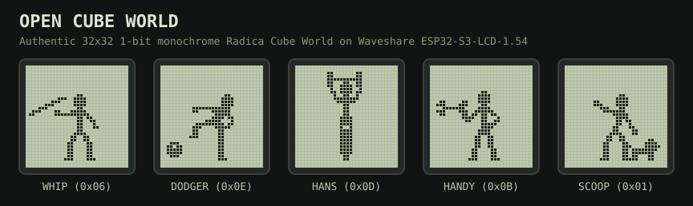
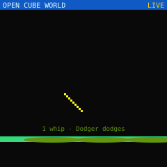
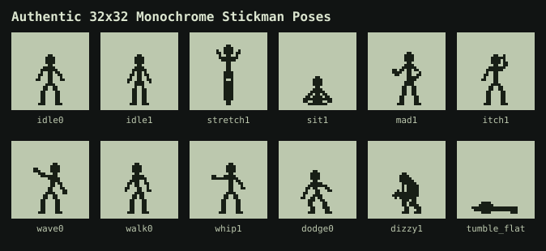

# OpenCubeWorld



**Radica Cube World (2005), faithfully reborn in authentic 32×32 1-bit monochrome LCD on the Waveshare ESP32-S3-LCD-1.54.**

Original Radica Cube World toys display lively **black-and-white stick figures** on a tiny **32×32 monochrome dot-matrix STN LCD** — no color, no cartoon scenery — and react to tilting, flipping, shaking, three front buttons, and magnetic single-wire links between cubes. OpenCubeWorld pairs the reverse-engineered single-wire protocol codec with an authentic 32×32 monochrome LCD stickman renderer, real QMI8658 6-axis IMU motion physics, and flicker-free 240×240 framebuffer output.



## Features

- **Authentic 32×32 1-bit monochrome LCD**: Crisp 7× dot-matrix pixel grid (`224×224` centered inside an 8 px recessed dark cube bezel), passive-matrix STN pixel persistence/ghosting, and 3 switchable monochrome palettes (`STN` olive-grey, `B&W` pure black-on-white, `INV` inverted).
- **31 authentic monochrome stick-figure poses + 12 props**: Idle, walk, stretch, cross-legged sit, scratch head, mad/stomp, kick, wave, whip, dodge, cube-turn tumble, dizzy/sick, dark-inverted sleep with rising `Z`s, iconic Radica power-on maze wipe-on, and lowering Venetian blind when a character visits a linked cube.
- **5 Radica characters** with 1-bit monochrome signature props:
  - **Whip** (`0x06`, Series 1) — rope / whip crack
  - **Dodger** (`0x0E`, Series 1) — bouncing ball
  - **Hans** (`0x0D`, Series 2) — overhead barbell
  - **Handy** (`0x0B`, Series 2) — wrench & sparks
  - **Scoop / Open** (`0x01`, Series 1) — his dog Spot
- **Live QMI8658 6-axis IMU physics**: Tilt left/right to lean & walk, flip upside-down for the authentic `CUBE TURN` tumble & recovery, shake vigorously to make the stickman `DIZZY`.
- **3 interactive views**:
  1. **Single Cube** — pure uncluttered 32×32 monochrome toy LCD
  2. **Linked World** — side-by-side linked mini-cubes with Venetian blind transfer + live 7-nibble protocol monitor
  3. **Debug / LCD Test** — live IMU crosshair, 32×32 LCD stripe/checkerboard pixel tests, and protocol summary
- **Real Radica Cube World single-wire protocol codec** (`CubeProtocol`) verified host-side against real 2 MHz logic-analyzer captures.



## Controls (Waveshare ESP32-S3-LCD-1.54)

Matches the 3-button + motion layout of the original toy (optional CST816 capacitive touch is auto-detected on Touch-LCD-1.54 boards):

| Input | Action |
|---|---|
| **Left button (GPIO 0 / BOOT)** | Short: cycle character (`WHIP`, `DODGER`, `HANS`, `HANDY`, `SCOOP`) · Long: cycle LCD palette (`STN` / `B&W` / `INV`) |
| **Center button (GPIO 5 / PWR)** | Short: play character signature trick (or WHIP in Linked mode / cycle test pattern in Debug mode) · Long: trigger Dizzy |
| **Right button (GPIO 4 / KEY)** | Short: switch mode (`Single Cube` → `Linked World` → `Debug`) · Long: Linked-Cube transfer (Venetian blind) |
| **Tilt / Flip / Shake (QMI8658)** | Lean/shift · Flip upside-down = `CUBE TURN` tumble · Shake = `DIZZY` |
| **USB Serial (115200)** | `s` status, `c` char, `p` palette, `a` action, `m` mode, `f` flip, `z` shake, `t` transfer |

## Build & Flash (PlatformIO)

Plug in your **Waveshare ESP32-S3-LCD-1.54** (or **ESP32-S3-Touch-LCD-1.54**) over USB-C and run:

```bash
pio run -e waveshare_esp32s3_lcd_154 -t upload
pio device monitor -b 115200
```

Additional environments in `platformio.ini`:
- `waveshare_cubelink` — live single-wire hardware link to a real Radica Cube World toy (GPIO 11, native 3.3 V)
- `waveshare_replay_dodger` — replays the captured `1Whip_1Dodger` logic-analyzer session

Full pinout and AVR/Uno fallback details: [`docs/hardware.md`](docs/hardware.md).

## The Protocol (30-second version)

Single wire, pull-up terminated, 3.3 V logic, ~7.4 ms per packet:

```text
PREAMBLE  L 234us | H 53us | L 94us
28 BITS   each bit = [H gap | L pulse]
            gap  ~140 before bit 0, ~200 between nibbles, ~100 within
            bit  L ~94us = 0,  L ~174us = 1
POSTAMBLE H ~57us | L ~93us
```

28 bits = 7 nibbles, MSB first (`[0]` type: `1` HELLO, `2` KEEPALIVE, `6` ACTION/WHIP, `7` BYE, `8` END; `[1..4]` payload; `[5]` sender id; `[6]` trailer `9` in 559/559 observed packets). Full spec: [`docs/protocol.md`](docs/protocol.md).

## Verification

Run the host-side protocol codec test against raw 2 MHz logic-analyzer pulse trains:

```bash
g++ -std=gnu++17 -Wall -Itest -Itest/stubinc -Ifirmware/libraries/OpenCubeWorld \
    test/protocol_test.cpp test/sim_arduino.cpp \
    firmware/libraries/OpenCubeWorld/cubeprotocol.cpp -o /tmp/protocol_test && /tmp/protocol_test
```

Regenerate `sprites.h`, monochrome PNGs, and SVG assets:

```bash
python3 tools/gen_sprites.py && python3 tools/gen_images.py
```

## Repository Layout

```text
platformio.ini                   ESP32-S3-LCD-1.54 build & upload config
firmware/
  OpenCubeWorld/                 main app (32x32 monochrome cube + IMU + buttons + touch)
  CubeLink/                      live 3.3V single-wire hardware link mode
  Replay_1Whip_1Dodger/          real capture replay 1
  Replay_1Whip_2Handy/           real capture replay 2
  Replay_1Whip_2Hans/            real capture replay 3
  libraries/OpenCubeWorld/       lcd32, qmi8658, world, cubeprotocol, cst816d, sprites.h
tools/
  gen_sprites.py                 1-bit monochrome stickman poses -> sprites.h + PNGs
  gen_images.py                  monochrome STN LCD SVG assets
  parse_captures.py              .sr capture -> packets.json
  gen_replays.py                 packets.json -> replay_data.h
docs/
  protocol.md                    full reverse-engineered protocol spec
  hardware.md                    Waveshare ESP32-S3-LCD-1.54 & Uno pin maps
test/                            host-side protocol unit tests
```

## Credits

- Protocol reverse engineering, captures & sigrok decoder: [npjg/radica-cube-world-hack](https://github.com/npjg/radica-cube-world-hack)
- Authentic 32×32 monochrome LCD research & stick-figure reference: [lowthergv/cubeworld](https://github.com/lowthergv/cubeworld) & TCRF
- Hardware pinout reference: [waveshareteam/ESP32-S3-Touch-LCD-1.54](https://github.com/waveshareteam/ESP32-S3-Touch-LCD-1.54)
- Display driver: [Arduino_GFX](https://github.com/moononournation/Arduino_GFX)

## License

MIT — see [LICENSE](LICENSE).
